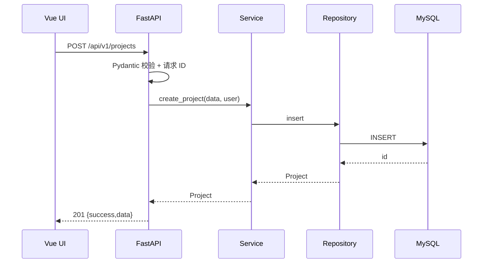
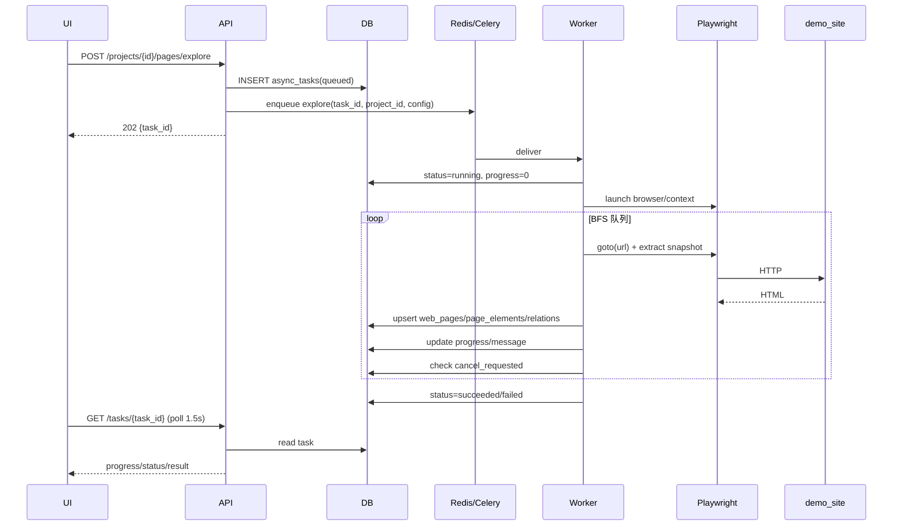
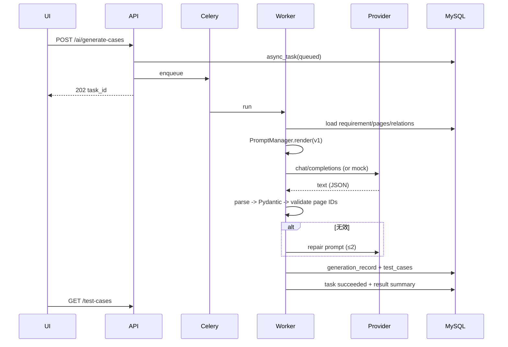
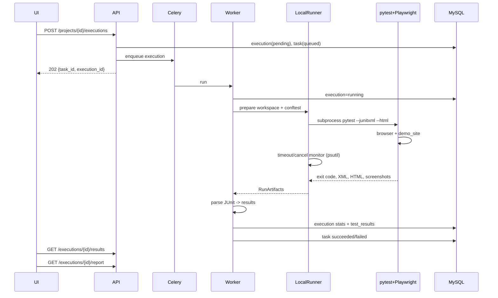
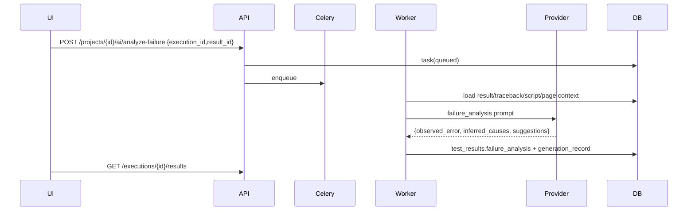

# SmartTest 架构设计

> 版本：v1.0（2026-11-03）
> 关联文档：`IMPLEMENTATION_PLAN.md`、`DATABASE_DESIGN.md`、`API_DESIGN.md`、`SECURITY.md`、`KNOWN_LIMITATIONS.md`

---

## 1. 目标与非目标

### 1.1 目标

- 单机可运行、可演示的 Web 测试平台：Vue 前端 + FastAPI API + MySQL + Redis/Celery + Playwright + OpenAI 兼容 LLM。
- 完成“项目 → 页面采集 → 业务流程 → 测试需求 → 用例 → 脚本 → 受控执行 → 结果/报告 → 失败分析”的闭环。
- 代码结构清晰，模块边界可解释，适合本科毕业设计答辩与后续扩展。
- 对不可信输入（页面内容、LLM 输出、生成脚本）有明确的安全处理与诚实限制说明。

### 1.2 非目标（本版本）

- 微服务、Kubernetes、服务网格、分布式调度。
- 多租户 SaaS、复杂 OAuth/SSO、计费。
- 验证码识别、登录/访问控制绕过、真实支付。
- 视觉回归、性能压测、代码覆盖率平台。
- 对任意公网站点做大规模爬取；只处理用户授权目标与本地 demo。

---

## 2. 架构风格与理由

### 2.1 模块化单体（Modular Monolith）

```text
Vue SPA  ──HTTP──>  FastAPI API  ──SQL──>  MySQL
                         │
                         ├── enqueue ──> Redis ──> Celery worker
                         │                              │
                         │                              ├── Playwright (scan/execute)
                         │                              ├── LLM client
                         │                              └── pytest subprocess
                         │
                         └── file metadata ──> storage/ (DOM/screenshots/logs/reports)
```

**为什么不是微服务/K8s**：

| 维度 | 模块化单体 | 微服务/K8s |
| --- | --- | --- |
| 部署 | 2–3 个进程（API/worker/前端） | 多镜像、编排、网络策略 |
| 调试 | 单仓库、单数据库、日志集中 | 跨服务追踪、契约管理 |
| 毕业设计演示 | 一条命令启动，风险低 | 环境要求高，易把时间耗在运维 |
| 扩展 | 先按模块拆分，后续可抽服务 | 过早拆分，边界不稳定 |
| 安全 | 本地/容器边界清晰 | 需要额外服务网格/策略 |

结论：保持**一个后端代码库 + 一个 Celery worker + 一个前端**；模块通过 service/repository 边界隔离，未来可按 AI/Browser/Execution 抽取。

### 2.2 同步技术栈

- SQLAlchemy 2.x **同步** Session + PyMySQL。
- Playwright Python **同步** API。
- Celery 任务同步执行。
- FastAPI 端点使用 `def`（线程池），不混用 async DB/浏览器。

**理由**：Windows 本地开发、Celery solo、Playwright 同步 API 的组合最稳定；异步栈会引入 event loop/线程/连接池的额外复杂度，对毕业设计收益低。API 层不做长任务，长任务全部进 Celery，因此同步端点不会阻塞事件循环太久。

### 2.3 任务状态以数据库为事实来源

Celery 的 result backend 只用于 revoke/AsyncResult 辅助；业务状态写入 `async_tasks` / `async_task_logs`。前端轮询 API，不直接依赖 Redis 中的 Celery 状态。这样：

- 重启 Redis 不会丢失业务任务历史；
- 任务进度、错误、结果可审计；
- 前端不需要理解 Celery 内部结构。

---

## 3. 逻辑分层与模块边界

```text
┌──────────────────────────────────────────────────────────────┐
│ Frontend (Vue 3 + TS)                                        │
│  views / components / api client / stores / router           │
└──────────────────────────────┬───────────────────────────────┘
                               │ /api/v1
┌──────────────────────────────v───────────────────────────────┐
│ API Layer (FastAPI routers)                                  │
│  参数校验、项目归属、统一响应、任务创建、文件下载            │
└──────────────────────────────┬───────────────────────────────┘
                               │
┌──────────────────────────────v───────────────────────────────┐
│ Service Layer                                                │
│  Project/Page/Workflow/Requirement/Case/Script/Execution/    │
│  LLMConfig/Task/Generation                                   │
└───────┬──────────────────────┬──────────────────────┬────────┘
        │                      │                      │
┌───────v────────┐   ┌─────────v─────────┐   ┌────────v────────┐
│ Repository     │   │ AI Layer          │   │ Browser Layer   │
│ SQLAlchemy     │   │ Provider/Prompt/  │   │ Policy/Parser/  │
│ project scope  │   │ Parser/Analyzer   │   │ Explorer        │
└───────┬────────┘   └─────────┬─────────┘   └────────┬────────┘
        │                      │                      │
┌───────v────────┐   ┌─────────v─────────┐   ┌────────v────────┐
│ MySQL          │   │ OpenAI-compatible │   │ Playwright      │
│ models/migrate │   │ + Mock            │   │ Chromium/Chrome │
└────────────────┘   └───────────────────┘   └─────────────────┘

┌──────────────────────────────────────────────────────────────┐
│ Execution Layer                                              │
│  validator / workspace / local runner / docker runner /       │
│  result parser / report manager                              │
└──────────────────────────────┬───────────────────────────────┘
                               │ subprocess / container
┌──────────────────────────────v───────────────────────────────┐
│ pytest + pytest-playwright + pytest-html                     │
│  workspace/storage/executions/{id}/                          │
└──────────────────────────────────────────────────────────────┘
```

### 3.1 模块职责

| 模块 | 职责 | 不做什么 |
| --- | --- | --- |
| `api/v1/endpoints` | HTTP 参数、状态码、项目归属、任务创建 | 不直接跑 Playwright/LLM/pytest |
| `services` | 业务规则、事务编排、跨模块调用 | 不写 SQL 细节、不拼 HTML |
| `repositories` | 查询/持久化、project 作用域 | 不包含业务判断 |
| `models` | 表结构、枚举、关系 | 不含业务流程 |
| `schemas` | 请求/响应/Pydantic 校验 | 不做数据库访问 |
| `ai` | Provider、Prompt、解析、生成器 | 不执行生成代码 |
| `browser` | URL 策略、浏览器、提取、BFS | 不生成测试用例 |
| `execution` | 校验、工作区、运行、解析、报告 | 不做业务 CRUD |
| `tasks` | Celery 入口、状态推进、取消检查 | 不写 API 响应 |
| `core` | 配置、日志、错误、加密、路径 | 不含领域逻辑 |

### 3.2 关键边界规则

1. **API 不执行长任务**：扫描、分析、生成、执行一律创建 `async_tasks` 并投递 Celery。
2. **项目归属贯穿全链路**：service/repository 查询必须带 `project_id`；子资源通过父资源解析 project。
3. **LLM 输出不可信**：先解析/校验，再入库；不直接执行脚本。
4. **生成脚本不可信**：AST/安全检查 + 独立工作区 + 超时；Docker 是强隔离边界。
5. **文件路径不可信**：所有存储路径经 `core/paths.py` 解析并校验位于 storage root 下。
6. **Mock 必须显式**：`is_mock`/`generation_source` 贯穿 DB/API/UI，不伪装真实模型。

---

## 4. 核心流程

### 4.1 同步 CRUD 流程



- 统一响应由 `core/errors.py` 的 envelope 处理。
- 事务在 service 层提交；失败回滚并返回结构化错误。
- 列表分页默认 20，最大 100。

### 4.2 页面探索流程（异步）



要点：
- 浏览器上下文在整个探索任务中复用，保持 Cookie；不自动提交表单。
- 每页解析后立即落库，前端可在任务完成前看到部分结果。
- 任务取消通过 DB 标志在页面边界检查；当前导航无法瞬时中断，超时兜底。

### 4.3 用例/脚本生成流程



要点：
- Prompt 记录版本、provider/model、is_mock、耗时、token。
- 每个用例/步骤/断言带来源；`model_inference` 必须显示“待确认”。
- 页面 ID 不属于项目 → 修复/拒绝，不静默写库。

### 4.4 执行流程



要点：
- 工作区唯一：`storage/executions/{execution_id}/`。
- 子进程环境白名单，不带主进程密钥。
- 取消：API 写 `cancel_requested`，runner 1s 轮询并杀进程树；Celery revoke 辅助。
- 本地模式不是沙箱；Docker 模式仅作为设计目标，当前未实现/未验证。

### 4.5 失败分析流程



输出必须区分：
- `observed_error`：来自日志/traceback 的事实；
- `inferred_causes`：模型推测，带 evidence/confidence；
- 不自动修改数据、不自动重跑。

---

## 5. 关键设计决策（ADR 摘要）

| # | 决策 | 选项 | 理由 | 代价/限制 |
| --- | --- | --- | --- | --- |
| ADR-1 | 模块化单体 | vs 微服务 | 部署简单、边界清晰、适合毕设 | 单点故障；未来需拆分 |
| ADR-2 | 同步 SQLAlchemy/Playwright | vs async | Windows/Celery/solo 稳定 | 高并发能力有限 |
| ADR-3 | MySQL 唯一主库 | vs SQLite/Postgres | 提示词要求；事务/JSON/迁移成熟 | 本机 9.4，Compose 8.0 |
| ADR-4 | Redis + Celery | vs 线程/APScheduler | 长任务隔离、可扩展、提示词要求 | Windows solo；需 Redis |
| ADR-5 | DB 为任务事实源 | vs 仅 Celery result | 可审计、可恢复、前端简单 | 额外表/更新逻辑 |
| ADR-6 | Playwright 同步 + BFS | vs Scrapy/Selenium | 真实浏览器/无障碍树/语义定位 | 资源占用高；SPA 限制 |
| ADR-7 | Provider 抽象 + Mock | vs 直接 OpenAI SDK | 可测试、可换供应商、明确 Mock | 需要维护两套实现 |
| ADR-8 | 两段式安全：AST + 隔离 | vs 仅黑名单 | 黑名单不足；容器是边界 | 本地模式仍非沙箱 |
| ADR-9 | 轮询而非 SSE | vs WebSocket/SSE | 简单、可靠、够用 | 延迟 1–2s |
| ADR-10 | 单用户 + owner_id | vs OAuth | 避免复杂认证；保留扩展 | 本地部署；非多租户 |
| ADR-11 | 本地+文件存储 | vs S3/对象存储 | 零外部依赖；易演示 | 单机容量/备份限制 |
| ADR-12 | 前后端类型对齐 | OpenAPI 生成 + 手写封装 | 减少漂移 | 需要生成步骤 |

---

## 6. 目录结构（目标）

```text
D:\Paper\
├── SmartTest_Project_Prompt.txt      # 原样保留
├── README.md
├── .env.example
├── .gitignore
├── docker-compose.yml                # 开发基础设施（MySQL 8 + Redis 7）
├── backend/
│   ├── alembic.ini
│   ├── requirements.txt
│   ├── requirements-dev.txt
│   ├── pyproject.toml                # ruff/pytest 配置
│   ├── migrations/
│   │   ├── env.py
│   │   └── versions/
│   ├── app/
│   │   ├── main.py
│   │   ├── core/
│   │   │   ├── config.py
│   │   │   ├── logging.py
│   │   │   ├── errors.py
│   │   │   ├── security.py           # Fernet / 脱敏
│   │   │   ├── paths.py              # storage 路径安全
│   │   │   └── time.py
│   │   ├── db/
│   │   │   ├── base.py
│   │   │   └── session.py
│   │   ├── models/
│   │   │   ├── base.py
│   │   │   ├── user.py
│   │   │   ├── project.py
│   │   │   ├── llm_config.py
│   │   │   ├── page.py
│   │   │   ├── requirement.py
│   │   │   ├── workflow.py
│   │   │   ├── test_case.py
│   │   │   ├── test_script.py
│   │   │   ├── execution.py
│   │   │   ├── task.py
│   │   │   └── generation.py
│   │   ├── schemas/
│   │   ├── repositories/
│   │   ├── services/
│   │   ├── api/
│   │   │   ├── deps.py
│   │   │   └── v1/
│   │   │       ├── router.py
│   │   │       └── endpoints/
│   │   ├── ai/
│   │   │   ├── providers/
│   │   │   ├── prompts/
│   │   │   ├── prompt_manager.py
│   │   │   ├── output_parser.py
│   │   │   ├── workflow_analyzer.py
│   │   │   ├── case_generator.py
│   │   │   ├── script_generator.py
│   │   │   └── failure_analyzer.py
│   │   ├── browser/
│   │   │   ├── browser_manager.py
│   │   │   ├── url_policy.py
│   │   │   ├── page_parser.py
│   │   │   ├── site_explorer.py
│   │   │   └── extractors/page_snapshot.js
│   │   ├── execution/
│   │   │   ├── local_runner.py          # 当前唯一已实现执行器
│   │   │   ├── script_validator.py
│   │   │   └── result_parser.py
│   │   │   # DockerRunner 未实现，见 KNOWN_LIMITATIONS
│   │   └── tasks/
│   │       ├── celery_app.py
│   │       ├── scan_tasks.py
│   │       ├── generation_tasks.py
│   │       ├── script_tasks.py
│   │       ├── execution_tasks.py
│   │       ├── failure_tasks.py
│   │       ├── celery_app.py
│   │       └── task_utils.py
│   └── tests/
│       ├── unit/
│       ├── integration/
│       └── conftest.py
├── frontend/
│   ├── src/
│   │   ├── api/
│   │   ├── components/
│   │   ├── composables/
│   │   ├── layouts/
│   │   ├── router/
│   │   ├── stores/
│   │   ├── types/
│   │   └── views/
│   └── package.json
├── demo_site/
│   ├── main.py
│   ├── data.py
│   ├── templates/
│   ├── static/
│   └── requirements.txt
├── scripts/
│   ├── dev_services.sh
│   ├── fetch_redis.sh
│   ├── verify_env.py
│   ├── seed_demo.py
│   └── e2e_demo.py
├── docker/
│   ├── backend.Dockerfile
│   └── runner.Dockerfile
├── docs/
│   ├── IMPLEMENTATION_PLAN.md
│   ├── ARCHITECTURE.md
│   ├── DATABASE_DESIGN.md
│   ├── API_DESIGN.md
│   ├── SECURITY.md
│   ├── KNOWN_LIMITATIONS.md
│   ├── TESTING.md
│   └── USER_GUIDE.md
├── storage/                          # gitignored
│   ├── projects/{project_id}/...
│   └── executions/{execution_id}/...
└── tools/                            # gitignored, 便携 Redis
```

---

## 7. 部署拓扑

### 7.1 本地开发（当前机器）

```text
MySQL 9.4 :3307 (项目独立 data dir)
Redis 8.10.3 :6379 (便携, 可选密码)
FastAPI   :8000 (127.0.0.1)
Celery    :solo worker
demo_site :8001 (127.0.0.1)
Vite      :5173 (proxy /api -> 8000)
```

启动顺序：`dev_services.sh start` → `alembic upgrade head` → backend → worker → demo → frontend。

### 7.2 Docker Compose（可选，当前未验证）

- `mysql:8.0` :3307、`redis:7` :6379；
- 可选 `backend`/`worker`/`frontend`/`demo-site` 服务；
- 执行器使用独立 `runner` 镜像（非 root、只读根、资源限制、挂载单次工作区）；
- 出口网络限制列为 P2：当前 Compose 仅提供基础隔离，**不要描述为已实现强出口策略**。

### 7.3 生产注意事项（非本版本目标）

- 必须启用认证/HTTPS/反向代理/限流；
- API 不得监听 0.0.0.0；
- 执行必须使用容器/沙箱，不能使用本地模式；
- Redis/MySQL 设密码、内网、备份；
- 文件存储权限最小化；报告下载需鉴权；
- 日志集中与脱敏；监控任务队列/磁盘。

---

## 8. 错误处理、日志与可观测性

### 8.1 错误分类

| 类别 | HTTP | 示例 |
| --- | --- | --- |
| 校验 | 422 | Pydantic 字段错误 |
| 未认证/无权限 | 401/403 | 可选 token 失败；项目越权 |
| 未找到 | 404 | project/page/case 不存在 |
| 冲突 | 409 | 重复执行、脚本未校验、配置缺失 |
| 上游 | 502/504 | LLM/浏览器/子进程失败 |
| 限流 | 429 | LLM 429（客户端有限重试后） |
| 内部 | 500 | 未捕获异常 |

统一 envelope，错误码稳定（如 `PROJECT_NOT_FOUND`、`LLM_NOT_CONFIGURED`、`SCRIPT_NOT_VALIDATED`）。

### 8.2 日志

- 每个请求生成 `request_id`，响应头 `X-Request-ID`。
- 结构化字段：timestamp、level、logger、request_id、task_id、project_id、event。
- 脱敏：`api_key`、`authorization`、`cookie`、`password`、`token`、DSN。
- 任务日志写 `async_task_logs`（有上限），详细执行日志写文件。
- 不记录完整请求体（含需求文本可接受，但排除密钥/会话）。

### 8.3 任务进度

- `progress` 0–100，`message` 简短中文。
- 扫描：每页更新；生成：调用前/解析后；执行：准备/运行/解析。
- 终态：`succeeded/failed/cancelled`；`error` 存脱敏摘要，详细 traceback 仅文件/受限 API。

---

## 9. 数据与文件一致性

- MySQL 存业务字段、JSON、相对路径；文件系统存 DOM/截图/日志/报告/原始响应。
- 写入顺序：先写文件（临时名/原子 rename），再写 DB；失败时清理孤儿文件。
- 读取：DB 路径 → `paths.resolve_within(storage_root, rel)` → 文件存在性检查。
- 执行工作区：`storage/executions/{id}/`，结束后保留（可配置清理策略）。
- 项目删除：软删除，文件保留；硬删除需显式管理员开关（默认关闭）。
- 大小限制：DOM 200 KB / 文本 8 KB / 截图 5 MB / 日志 2 MB / 脚本 60 KB / LLM 原始响应 256 KB。

---

## 10. 扩展路径

1. **多用户/团队**：users/roles/project_members，API token/OIDC；现有 owner_id 可迁移。
2. **执行隔离**：DockerRunner → 独立 runner 服务/队列；出口代理按域名 allowlist。
3. **任务体验**：SSE/WebSocket 替换轮询；任务优先级/并发池。
4. **AI 增强**：多模型路由、成本统计、缓存、人工反馈闭环。
5. **采集增强**：SPA 等待策略、可访问性树、表单安全提交、登录态管理。
6. **报告**：Allure、历史趋势、失败聚类、截图对比。
7. **部署**：Compose 全栈 → 单机 systemd → 云上容器；仍不建议 K8s（除非有明确需求）。

---

## 11. 架构验收清单

- [ ] API 层没有直接执行 Playwright/LLM/pytest 的代码。
- [ ] 每个子资源查询都能追溯到 `project_id`。
- [ ] 长任务都有 `async_tasks` 记录和可轮询状态。
- [ ] 所有 LLM 输出先 Pydantic 校验再入库。
- [ ] 所有生成脚本先 AST/安全校验再允许执行。
- [ ] 所有文件路径经 storage root 校验。
- [ ] Mock/真实 LLM 在 DB/API/UI 可区分。
- [ ] 本地执行模式在 UI/文档有显著风险提示。
- [ ] Docker 未验证项在文档中明确标注。
